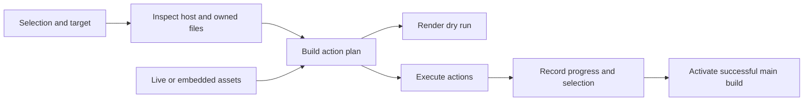

# Architecture

ds is one Go CLI with two asset sources. The [entrypoint][main] stays thin,
[`internal/cli`][cli] maps [Cobra][cobra] commands onto domain operations in
[`internal/ds`][ds], and [`internal/assets`][assets] reads assets from a
checkout or from the snapshot embedded in a main build. CI tooling lives in
[`internal/build`][build].

## Execution modes

| Mode       | Assets                                             | `upgrade ds`                                   |
| ---------- | -------------------------------------------------- | ---------------------------------------------- |
| Checkout   | Live files in the checkout and configuration repos | Fast-forward sources, rebuild, resume          |
| Main build | Snapshot compiled into the executable              | Fetch and verify the latest build, then resume |

The build selects the mode, never the working directory. The checkout launcher
compiles with the checkout root linked in; main builds compile with the
`dsembed` tag and the snapshot. An installed main binary run inside a checkout
stays in main mode.

`<config>/ds/config.toml` selects live configuration checkouts in checkout mode;
siblings named `nvim.conf`, `tmux.conf`, and `kitty.conf` are the default:

```toml
[sources]
nvim = "~/src/nvim.conf"
```

## Convergence



One plan serves both preview and execution. Planning inspects the host and the
target's files and records blockers: conflicts without `--force`, missing
sources, unsupported platforms, and missing privileges or package managers. A
blocked plan never executes. Actions are concrete types, not shell snippets, and
every external command receives an argument array.

Actions run in this order: stage the main build, fetch mise when no compatible
one exists, install native packages, build checkout helpers, converge files,
activate the main build, install mise tools, and bootstrap Neovim plugins.
Activation precedes tool installation because configuration links resolve
through the activated build.

Execution rechecks each file's state before changing it and stops if the file
changed since planning. Each run writes an operation record under
`<state>/ds/operations`; a failure names the failed action, and a rerun
converges from observed state. Package installs, downloads, and file edits are
not one transaction.

## Ownership

| Kind           | Owned when                                                     |
| -------------- | -------------------------------------------------------------- |
| Symlink        | It points at the desired asset, a recorded source, or ds roots |
| Rc block       | Content sits between `# >>> ds managed >>>` markers            |
| Generated file | Its digest matches what ds last wrote                          |

ds replaces only owned content. Anything else is a conflict that `--force` moves
to `<state>/ds/backups/<time>`. Blocks preserve content around them, and ds
never edits a symlinked rc file. `<state>/ds/state.json` stores the selection
and ownership records. An advisory lock on `<state>/ds/lock` serializes
mutations of one target; the process holding it can pass it to the next ds
during an upgrade.

## Tools and packages

ds writes tool requests to `<config>/mise/conf.d/10-ds.toml`. mise loads
`conf.d` fragments before `config.toml`, so user declarations override ds
defaults; see [mise configuration][mise-config]. ds installs and inspects only
the tools of selected components, outside any project configuration.

Native packages install through [mise's package bootstrap][mise-bootstrap] with
Homebrew on macOS and apt on Ubuntu, only when a component's commands are
missing. When no compatible mise exists, ds downloads a pinned release, verifies
its checksum, and links it into `~/.local/bin`.

## Main build layout

A main build stages under `<data>/ds/builds/<build-id>`: the executable,
`assets/<repository>/`, and `build.json`, written last to mark completion.
`<data>/ds/current` points at the active build; `~/.local/bin/ds` and every
configuration link resolve through it. Activation is a same-directory symlink
rename. ds keeps the active and previous builds and removes older ones.

[assets]: ../internal/assets
[build]: ../internal/build
[cli]: ../internal/cli
[cobra]: https://github.com/spf13/cobra
[ds]: ../internal/ds
[main]: ../cmd/ds/main.go
[mise-bootstrap]: https://mise.jdx.dev/cli/bootstrap.html
[mise-config]: https://mise.jdx.dev/configuration.html
